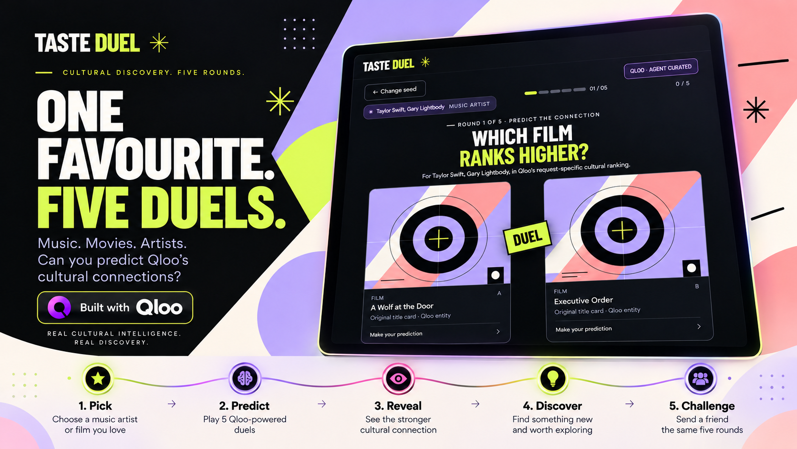
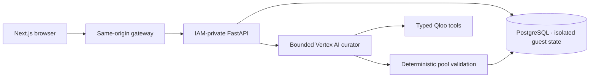

<p align="center">
  
</p>

<h1 align="center">Taste Duel</h1>
<p align="center"><strong>One favourite. Five duels. Your move.</strong></p>
<p align="center">
  <a href="https://tasteduel-web-902056825143.asia-south1.run.app"><strong>Play Taste Duel ↗</strong></a> ·
  <a href="docs/playing.md">How to play</a> ·
  <a href="docs/architecture.md">Architecture</a> ·
  <a href="docs/README.md">Documentation</a>
</p>
<p align="center">
  <a href="https://github.com/saimaharana4/taste-duel/actions/workflows/ci.yml"></a>
  
  
  <a href="LICENSE"></a>
</p>

Choose a music artist or film you love. Predict which of two contenders Qloo ranks higher for that favourite. Reveal the connection, save something unexpected, and send a friend the same five rounds.

**Your score measures prediction performance. Your taste is yours.**

## Five rounds. A few new favourites.

| | Your move |
|---|---|
| **Say hello** | Choose a nickname for this guest session. Friends can see it on invitations and results. |
| **Pick a favourite** | Search for a music artist or film and choose a supported cross-domain journey. |
| **Make the call** | Predict the higher-ranked contender, reveal the accepted answer, then continue. |
| **Keep the discovery** | Save a contender you want to explore. Saves are your choice, separate from correct answers. |
| **Poke a friend** | Share an invitation to the exact same five rounds. Compare independent scores and a lightly sarcastic verdict. |

Friend challenges freeze the round order and sides. Sharing uses native sharing where available, with clipboard and manual-copy fallbacks. Both players can return to the verdict while their sessions and challenge remain valid.

## Cultural discovery with evidence

**Qloo supplies the ranking. Vertex AI curates the journey. The server owns the score.**

Qloo provides request-specific cultural ranking evidence across music and film. A bounded Vertex AI curator proposes a supported strategy; deterministic validation checks the candidate pool before any round is delivered. An LLM cannot invent the answers or change a completed game.

Coverage varies by seed. When there is not enough evidence for five valid rounds, Taste Duel explains the limitation. Answering, saving, sharing, replaying and comparing scores do not trigger additional Qloo or model calls.



## Built for a proper duel

- **Authoritative gameplay:** five rounds, accepted-answer recovery and server-calculated scores.
- **A fair rematch:** frozen challenge replay with independent answers and scores.
- **Guest privacy:** no account required; nicknames are labels, not login identities. Secure cookies identify sessions.
- **Designed to play:** keyboard controls, reduced motion, responsive layouts, original title cards and locally hosted fonts.
- **Short-lived state:** inactivity expiry blocks access immediately. Recurring bounded cleanup removes expired records; backups follow a separate retention policy.

[Gameplay details](docs/playing.md) · [Friend challenges and retention](docs/named-challenges.md) · [Security and privacy](docs/security.md)

## Run locally

Requires Docker Desktop. From the repository root in PowerShell:

```powershell
.\scripts\tasteduel-compose.ps1 preflight
.\scripts\tasteduel-compose.ps1 up
.\scripts\tasteduel-compose.ps1 health
```

Open [the web app](http://127.0.0.1:13001) or [API documentation](http://127.0.0.1:18005/docs).

Default startup disables external providers and reports that state honestly. Use the [container guide](apps/api/CONTAINERS.md) for the labelled fixture demo or genuine provider configuration.

```powershell
.\scripts\tasteduel-compose.ps1 down
```

Stopping preserves the local database volume.

## Find your way around

```text
apps/
  api/                 FastAPI, domain rules, provider adapters and migrations
  web/                 Next.js interface and same-origin API gateway
packages/contracts/    Exported OpenAPI and generated wire contracts
runtime/               Locked Python and Qloo runtime dependencies
infra/
  containers/          Production image definitions
  terraform/           Cloud resources, IAM and monitoring
  releases/            Immutable release manifests
  migration/           Dated deployment and preservation evidence
docs/                  Product guides and operational documentation
scripts/               Development, verification and release tooling
tests/                 API, database and browser verification
third_party/           Font and artwork notices
ai/                    Design specifications and historical engineering records
```

**Stack:** Next.js · React · TypeScript · FastAPI · PostgreSQL · Qloo · Vertex AI · Cloud Run · Terraform.

## Explore further

| Guide | What you will find |
|---|---|
| [How to play](docs/playing.md) | Predictions, reveals, discoveries and friend challenges |
| [Architecture](docs/architecture.md) | Provider boundaries, contracts and authoritative transactions |
| [Operations](docs/operations.md) | Local setup, production releases, monitoring and recovery |
| [Verification](docs/verification.md) | Recorded checks and the limits of the evidence |
| [Security](docs/security.md) | Private answers, session isolation and secret handling |

Automated checks cover database isolation, response-loss recovery, exact replay, keyboard and mobile layouts, privacy and accessibility scans. These checks do not replace native-device sharing, screen-reader testing or human feedback; see the verification guide for current boundaries.

## Licence

Source is [MIT licensed](LICENSE). Fonts and artwork retain their [separate notices](third_party/README.md).