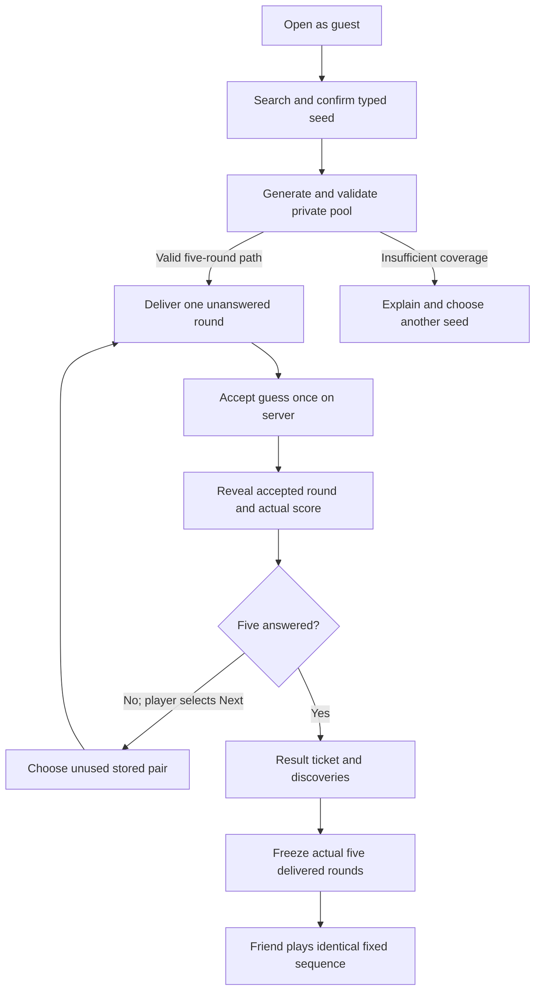
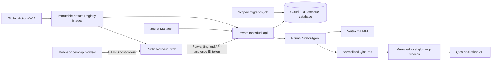
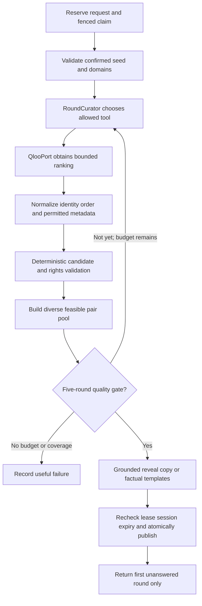

# Taste Duel architecture

**Release status - 29 October 2026:** [Taste Duel is public](https://tasteduel-web-902056825143.asia-south1.run.app). The unchanged `e49564c` application passed genuine Qloo/Vertex five-round solo, saved discovery and exact friend replay on the sealed production configuration, followed by unauthenticated public replay and typed search. API access remains IAM-private; schema is `td0011`. Readiness monitoring passed, and compatible rollback/return preserved all 14 history-table hashes and counters with expiry enforced. Active replay during rollback was not retested after its evidence expired. [Actual evidence and limitations](../infra/migration/production-release-execution-2026-10-28.md). Earlier implementation entries below are dated history, not the current release status.

Dated checkpoints below are historical implementation evidence; superseded deployment/cost statements are not the current operational status. The current record above takes precedence.
### Cloud ownership and release boundary — 27 October 2026

Read-only inventory and allowlisted state review found 61 saved ownership records
at serial 16. Preserve root-owned `accesslife` database/user and `accesslife-db`;
new Taste Duel ownership is a planned separate module/address contract, not an
implemented resource. [Foundation](../infra/migration/foundation-plan.md) and
[image-dependent release](../infra/migration/release-plan.md) are separate reviews.
Selected state/live fields match; source scheduler defaults differ from its live
enabled setting. No refreshed authenticated action plan is approved. Cost is
BLOCKED and cloud migrations/runtime still enforce local-only database guards.

### Product validation and accounting — 27 October 2026

`td0010` adds forced-owner-RLS `product_events`. Fixed-field facts commit with
ready-game, accepted-answer, completion, explicit-save and challenge mutations;
semantic unique keys deduplicate retries. No browser event endpoint, arbitrary
payload, public analytics reader or second contract schema was added. Clear
deletes live owner events; seven-day event expiry is independent of Qloo evidence
TTL. Local report/purge commands are scope-checked; production expiry scheduling
remains a deployment prerequisite. See [accounting policy](product-event-accounting.md).

The [quality matrix](round-quality-validation.md) retains the versioned pool
policy and frozen snapshots. Its eight sequential typed-HTTP calls do not resolve
canonical harness gaps or demonstrate richer explanations/category diversity.
[Human validation](playtest-protocol.md) remains pending. Earlier records below
describe historical implementation checkpoints.

### Prompt 13 audit boundary - 27 October 2026

A per-response proxy generates script nonces and forces request-time shell
rendering. Shared PostgreSQL usage_budgets/td0009 admits verified guests and
reserves daily Qloo/Vertex envelopes across participating instances. Request
bytes/chunks/time, error messages and provider/cache boundaries are bounded.
Curation/evidence stays allowlisted and accepted-state authorized. Production
HTML/RSC/DTO/OG and log contracts passed synthetic exposure checks; no upstream
provider call occurred. The stable guest header removes a measured CLS failure.
[Measured setup, policy and remaining release gates](../apps/api/AUDIT.md).

### Historical Prompt 12 boundary - 27 October 2026

`ChallengeService` creates one high-entropy capability per completed owned solo
game, with idempotency receipts. `td0008` freezes delivered orientations, order,
context and versions. Guest copies contain only those five pairs and use fixed
selection, preserving independent scores without provider IO. Hash-scoped RLS
lookup is server-only; public invitation DTOs contain no answer/pool/creator data.
Owner revocation/clearing also blocks started replays and replay-only discovery
support. Fixed replay resharing is prohibited to preserve the parent's revocation.
Canonical-origin configuration, anonymous bounded server metadata reads, no-store
routes and original local-font social cards implement sharing. No cloud changed.
[Contracts, retention and verified local boundary](../apps/api/CHALLENGES.md).
The earlier boundaries below describe their historical deliveries.

### Historical Prompt 11 boundary — 26 October 2026

`domain/adaptive.py` selects from frozen pairs while retaining a complete no-repeat
continuation and original diversity requirements. `GameplayService` freezes
private policy/seed and delivered orientation under the existing transaction.
Additive `td0007` preserves legacy fixed-path games. Scarce-band fallback is
reason-coded privately; snapshots/winners remain immutable. Weighted private side
patterns avoid a forced final answer. Selection data never enters public DTOs.

`DiscoveryService` records only explicit accepted-contestant saves and serializes
save/unsave/clear by session. Collection contracts add expired count/session expiry.
Cross-tab hints carry no entity/answer data; views refetch and ignore revoked late
responses. [Implementation/restart proof](../apps/api/SOLO.md). Prompt 12 must
migrate challenge-side freezing before enabling replay. No cloud resource changed.

Revision 12 - 26 October 2026 - Prompt 11 adaptive solo/discoveries; cloud remains unchanged.

### Prompt 10 browser integration boundary

The default shell uses generated application contracts through a strict same-origin
Next route. Fixed method/path/query/header allowlists, streamed byte bounds,
origin validation, rewritten host-scoped cookies, safe diagnostic envelopes and
optional server-only metadata IAM separate browser identity from private API access.
The IAM path is synthetic-tested; no deployed connectivity is implied.

Typed artist/movie search cancels stale results and requires explicit identity
selection. Client generation/answer/Next intents retain the same body/key across
uncertain responses. Owned GET restores the accepted reveal; preparation observes
the generation lease and offers explicit recovery. Only the current two choices
arrive before acceptance; no global summary arrives before five answers.
`features/gameplay` contains this transport-facing presentation layer, separately
from development-only fixtures. Server-owned score, mode and accepted evidence
drive the result ticket and factual Why-this-duel disclosure.

Original local title cards are the complete artwork policy. Exact owned IDs are
allowlisted; unapproved provider metadata never triggers a fetch. No external
image proxy exists. See [integration commands, security and actual verification
boundaries](../apps/web/INTEGRATION.md). Prompt 8's live corrective-value gate,
canonical MCP typed resolution, broad coverage and cloud rollout remain open.

### Historical Prompt 9 boundary at delivery

`GameplayService` owns transactional reservations, fenced claims, atomic
publication, answers and advancement. The awaited request releases its authentication
transaction before generation; it commits private snapshot/pairs/path, first delivery
and validated full receipt before returning ready. Session-first locks serialize
clear/publication and conflicting mutations. A 30-second lease fences a 20-second
publication deadline; the same input/key may reclaim an expired claim at most three
times. `202` observes an active request, not a queued job. Status GET returns only
coarse state/lease/recovery fields. Cancellation cannot instantly kill SQL; bounded
transactional commit and fencing determine the retryable authoritative outcome.

Additive `td0006` retains prior migration bytes, stores the full private receipt,
maps external provider IDs to guest-local entity IDs and preserves mutation outcome
revisions across later progress. Answer and Next use stored evidence only. All
unplayed pairs stay private; global curation summaries are withheld until five
answers are complete. The initial selector follows the proven witness path;
performance adaptation remains Prompt 11. [Gameplay contract and proof](../apps/api/GAMEPLAY.md)
include empty-database migration and real API-process restart checks. New tests use
synthetic contracts; no new Qloo/Vertex or cloud call closes the historical live gate.

### Prompt 8 boundary at delivery

The private `RoundCuratorAgent` now makes native Vertex function-call decisions
through a typed model port. Actual application tools are `inspect_seed`,
`fetch_ranked`, `evaluate_pool`, `finish_pool` and `stop`. A fetch returns bounded
deterministic feedback; the model may select a known validated pool, make one
reason-supported strategy correction or stop. It receives no candidate titles,
scores, winners or private pairs. The full objective, limits, current live ledger
and source links are in [Prompt 8 curator evidence](https://github.com/saimaharana4/accesslife-ai/blob/ef5c27c6b1aff925dd504b371dff99e128a2f77b/ai/prompt8-curator.md).

Pin `gemini-3.1-flash-lite`/`global`, Google Gen AI `2.33.0`, explicit IAM/ADC,
minimal thinking, 512 output tokens and one SDK attempt. The generation boundary
is 20 seconds, six actual Qloo HTTP dispatches, normally two/hard four Vertex
attempts, eight tool steps, one correction and a 24,000-token admission envelope.
One native-tool model smoke and one genuine grounded curator run passed. The
curator chose 20 movie candidates, inspected deterministic feedback and selected
a ready 15-pair pool with a five-round path in 5,359 ms (two model requests, one
Qloo ranking request). This resolves Prompt 7's real-sample gate for this sample.
No natural correction occurred; live adaptive correction remains unverified.
No cloud changes or browser integration occurred.

The pinned MCP process remains the default/preferred transport, but its live typed
resolution still failed closed. An explicitly configured
`http_ranked` adapter closes the documented compact-score/type/sort gap behind
the same typed port/admission guard; it is not a silent transport fallback.
An additional `qloo_http_typed_search=true` opt-in preserves actual returned
types and ambiguity through independently tested GET `/search`; the successful
live run used this path. A pre-harness type-preservation shim is synthetic-tested,
but did not establish live canonical resolution. Unknown compact ordering remains
rejected. Per-key shared controls protect only
participating runtimes; an overlapping legacy reader is a rollout blocker until
stopped or coordinated. New in-memory receipt trace/token/feedback fields are
private; Prompt 9 now adds SQL persistence, fencing and atomic game/receipt
publication. Never serialize the receipt as a public status response.

The default web entry point is now the connected Taste Duel frontend; the isolated development fixture remains available under its explicit flag. `apps/api/src/tasteduel` contains the independent local domain/API/read foundation and authoritative gameplay. Legacy entry points, Compose and recorded deployment remain AccessLife. Historical verification remains in [memory.md](memory.md) and Git history; it does not validate cloud migration. [prompts.md](prompts.md) controls later iterations.

**Implemented frontend boundary through Prompt 4:** Next.js server layout/pages, local licensed fonts/original SVG art, React Aria seed confirmation, reusable tokens/primitives and a client fixture provider/adapter. Five invented rounds compute the result from accepted answers, support save/unsave and derive a local invitation from the played sequence. No network provider, database, durable session, model, production scoring service or share link is involved in that browser flow. `/api/v1/*` still returns local `503 PROTOTYPE_ONLY`; forwarding is future work. Synthetic winners are public development code, not a secrecy implementation for real answers. Six legacy web modules/seven dependencies were removed in Prompt 3; three superseded single-round/result/invitation specimens were removed in Prompt 4. Old source stays in the preservation tag. Prompt 5 replaces unused legacy API declarations with generated Taste Duel wire types, without connecting the fixture browser.

### Historical Prompt 4 frontend boundary

- `app/` keeps pages/layout as Server Components; bare `tasteduel-fixture-entry` resolves to a client fixture entry only for the explicit development-server phase/flag. Other phases use a separate unavailable entry that imports no fixtures. Normal production builds exclude fixture pools/controls, even when the flag is set; their routes return 404.
- `app/tokens.css` and `components/ui/` own Button/ActionLink, RoundPips and StatusPanel. `features/{seed,duel,reveal,results,challenges,discoveries,curation}` own focused presentation components.
- `features/fixtures/` owns UI-only types, discriminated reducer, synchronous duplicate guards, operation identities, abort/recovery and `FixtureTransport`. The in-memory implementation accepts then simulates response loss; the same answer key recovers one accepted answer. No browser storage, backend or external requests are used.
- State sequence: idle → preparing → unanswered → submitting → revealed → advancing → unanswered/complete, with explicit issue/retry/interruption branches. Only the final explicit Next initiates result navigation; restored arenas cannot auto-redirect Back. Refresh intentionally clears state.
- `features/reveal/WhyThisDuel` accepts an **accepted-round-only** presentation contract: source label, factual ranking-context sentence, optional supported explanation/attribution and discovery action. `fixtureDisclosure` produces this only for the current revealed/advancing answer. No unsupported explanation is supplied.
- `features/curation/CurationSummary` explicitly projects typed domain/mode/count/path facts; it accepts no raw receipt, private reasoning, scores, contestant list or pair/answer data. Here it is nested inside the post-answer disclosure with unmistakable synthetic/no-agent labels. Later allowlisted API DTOs replace fixture facts; these UI types do not define the API.

Fixture tests prove local behavior only. Prompt 5 adds owned read isolation and storage checks below; authoritative gameplay mutations, adaptive pools, live MCP/Vertex and exact two-session challenge replay remain future gates. Prompt 6's private transport is described separately below. Production exclusion is a build boundary, not proof of future server secrecy.

### Prompt 5 backend foundation

`domain` owns bounded values/private receipt and canonical signature helpers; `ports` defines bounded immutable read values; `application` enforces read state/ownership; `adapters` loads scoped relational data; `api` explicitly projects public Pydantic DTOs; `persistence` owns SQLAlchemy rows and lazy scoped transactions. Import/export never opens a database, calls a provider or migrates data. No new dependency or legacy planner import is required.

The isolated PostgreSQL 16 database is `127.0.0.1:55435/tasteduel_prompt5`, schema `tasteduel`. Nineteen tables and separate `td0001`–`td0004` forward migrations use migration-owner/runtime roles; no spatial/vector extension. Composite owner references, forced RLS, immutable evidence/answers/challenges, sequential delivery, derived correctness and typed mutation receipts enforce database invariants. The trusted session GUC is not cryptographic SQL authentication: only the server sets it after validating the full random cookie hash, and DB credentials remain private. The initial possible session row is selected by cookie UUID before hash validation; no private game query occurs until authentication succeeds.

The private `CurationReceipt` stores strict structured execution facts and versions, no freeform reasoning/raw response/pool. Its public summary is an explicit successful-receipt projection returned only with accepted evidence here. Mutation receipts store canonical signature hashes and typed owned references, never raw request/response JSON. Completed answer receipts require an accepted answer and exact game revision at completion; saved revisions survive later advancement. These storage guards do not implement HTTP idempotent executors or generation leases.

Only sessions, health and owned game/round/result/discovery reads are connected. Other declared routes return `501 FOUNDATION_NOT_IMPLEMENTED`; database-seeded synthetic graphs prove projections, not a working live creation/answer/replay path. `/api/v1` forwarding remains disabled. Generated frontend declarations now come from this application's actual OpenAPI; no Qloo meta-schema or hand-maintained wire schema is used. See the [API foundation guide](../apps/api/README.md) and [migration guide](../apps/api/tasteduel_migrations/README.md).

**Prompt 2 evidence:** the [dated source/capability matrix](qloo-capability-matrix.md) pins harness `0.1.26` and official source commits. Twelve counted requests proved two raw cross-domain samples with five-pair numeric feasibility; canonical MCP Insights and same-domain cells remain unverified. No live payload or generated API client is committed. The advertised OpenAPI file is a meta-schema without endpoint paths and is rejected for code generation. This is a partial feasibility gate, not an implemented provider or game.

## 1. Product flow and decisions

### Prompt 7 deterministic engine, implemented offline

`domain/duel_pool/` owns typed private snapshots, validation, fingerprinted v1
policy, exact matching and continuation-safe options. `application/pool_preparation.py`
binds typed Qloo evidence to confirmed seed/request/time context without
promoting unverified ordering. `pool_feedback.py` explicitly projects private
aggregate tool feedback. `api/pool_projection.py` projects one choice through
existing DTOs and owned artwork only; no HTTP delivery/mutation is connected.
There are no schema/migration/frontend changes or provider/model/cloud calls.

The five-round matching is hard; sourced category then gap-band variation is a
bounded journey objective. Unknown categories remain unknown. The 25,000-state
limit distinguishes unproved evaluation from proven insufficient coverage;
objective limits never revoke a valid witness or claim global optimality.
Prompt 9 persists the full policy configuration/fingerprint and exact oriented
private witness path. Replay reads frozen choices and winners; it never needs to
regenerate them from the ephemeral server RNG seed. Detailed
semantics, safe feedback and tests are in the [pool guide](../apps/api/DUEL_POOL.md).
The real-sample gate remains blocked: Prompt 2 retained aggregates only, while
MCP ordering/score precedence are still unverified. No additional calls occur.

### Prompt 6 implemented provider boundary

`ports/qloo.py` defines frozen private resolution/candidate/evidence values.
`adapters/qloo/` owns schema validation, six-envelope normalization and the
managed MCP child; `adapters/qloo_policy.py` owns shared admission and budgets.
`api/provider_runtime.py` is the composition root: explicit Secret Manager
reference lookup through server ADC, adapter wiring and API lifespan teardown.
Domain/application consumers receive typed values, never provider dictionaries;
no new provider route or browser forwarding is connected in this stage.

`runtime/qloo` pins Node 24.18.1 / harness 0.1.26 with npm lock and the offline
discovered three-workflow schema snapshot. Startup verifies exact schemas and
checksum; the runner injects a one-attempt QlooClient rather than using CLI/home
configuration. Every GET to the fixed event host first requests parent admission,
including hydration. Child env is limited to PATH/SystemRoot/TEMP/TMP plus the
explicit key; stdout is MCP only and arbitrary stderr is discarded. One child
per API lifespan serializes workflows; queue+call deadlines, bounded restart
and kill/reap on active cancellation handle the harness cancellation gap.

The additive `td0005` creates the twentieth table, `ProviderControl`, scoped by
private key fingerprint under forced RLS. Atomic SQL admission shares minute
counts, spacing, circuit and authentication blocks across instances. No guest
can select its scope through HTTP. Like session GUCs, the scope GUC is trusted
backend context, not cryptographic SQL identity. Runtime has SELECT/INSERT/UPDATE
only; no public API exposes this table. Existing applied migrations are unchanged.

A required request context caps all workflows/retries at six upstream requests
and twenty seconds. Default admission is thirty/minute with 200 ms spacing;
three eligible transient failures open thirty seconds, authentication is sticky,
and only one eligible transient retry is allowed. These application limits do
not establish event quota. Legacy services bypassing this store remain outside
its protection and require coordination before any live cutover.

The isolated [backend image](../infra/containers/tasteduel-api.Dockerfile) uses
digest-pinned bases and separate minimal Python/npm locks. Legacy images and CI
are unchanged. No raw HTTP fallback or live call was added. Normalization keeps
compact affinity private and `ordering_verified=false`; image rights are false,
supported explanation absent. The [runtime guide](../runtime/qloo/README.md)
records the remaining canonical Insights/order/type-context gate before genuine
pool claims. Offline transport completion is not live-game completion.

A guest selects one favourite cultural entity, predicts five Qloo comparisons, receives a score out of five, saves discoveries and challenges a friend to the same five rounds. Initial seed/target domains are music artists and movies, subject to Prompt 2's live coverage and rights gates. Book/person support is later; a director's name must not silently resolve as a movie.

The question is **“Which ranks higher for this seed in Qloo's taste graph?”** Qloo supplies a query-specific aggregate ranking, not universal truth, an individual's preferences or a probability of enjoyment. Contestants in one duel share a target type and frozen query context. Different target domains can supply separate rounds; their scores are never compared.



| Layer     | Target                                                                  | Boundary                                                               |
| --------- | ----------------------------------------------------------------------- | ---------------------------------------------------------------------- |
| Web       | Next.js App Router, strict TypeScript, Tailwind, React Aria, Motion     | Server shell, narrow search/game/reveal client boundaries; original UI |
| API       | FastAPI, Pydantic, SQLAlchemy, Alembic                                  | Modular application, not a deployed service per tool                   |
| Agent     | One bounded RoundCuratorAgent through Google Gen AI/Vertex              | Genuine tool decisions; never model-written winners/scores             |
| Culture   | Official pinned Qloo harness through local stdio MCP                    | Trusted backend only, normalized QlooPort                              |
| Rules     | Deterministic validators, DuelPoolBuilder, GameEngine, ChallengeService | Server-authoritative eligibility, scoring, adaptation and replay       |
| Storage   | PostgreSQL 16 ordinary relational tables                                | No RAG, embeddings, spatial/vector requirement or Redis                |
| Execution | Bounded awaited request plus persisted reservation/lease                | No unowned post-response generation or required queue worker           |
| Runtime   | Node 24, Python 3.12, exact compatible dependencies/lockfiles           | Backend image also includes tested Node/harness; no runtime npx        |
| Cloud     | Cloud Run web/private API, reused dedicated SQL, migration job          | Terraform and GitHub Actions WIF; optional storage only if needed      |

LangGraph, Cloud Tasks and extra services require a measured missing capability. They are not inherited because AccessLife already used them.

## 2. Deployment and trust boundaries



Browser requests use same-origin `/api/v1/*`; Next.js forwards allowed paths to private FastAPI `/v1/*`. Validate mutation origins, strip untrusted internal identity headers and add an IAM ID token. Its audience stays the API service URL even for revision-tag testing. IAM-private is not network-only ingress; unauthenticated direct requests must fail.

Guests have cryptographically random host-scoped Secure/HttpOnly/SameSite=Lax cookies in production; only token hashes are stored. API checks ownership independently of the browser. No shared parent `.run.app` cookie or old/new-origin guest migration is assumed. Private game/session/answer/discovery responses are `no-store` and cannot enter shared RSC/CDN caches. Public challenge invitations grant no creator-session/game access.

Web gets API invocation, not database/secret access. API gets minimum required Qloo/database secrets, Cloud SQL and Vertex permissions. Migration owner and runtime DML principal are separate. Local genuine-provider mode uses ADC plus Secret Manager references; CI uses synthetic contracts. Keys never enter browser bundles, public MCP config, Terraform plaintext state, command arguments or model prompts.

The official `qloo mcp` is a local stdio process managed once per API instance through the Python MCP client. Pin Node/harness; discover `listTools()` schemas; allowlist necessary workflows; bound concurrency/startup/restarts; sanitize stderr; preserve stdout protocol framing; close on shutdown. Forward only required child environment variables. Docs MCP is development reference only. Raw HTTP may be a separately tested explicit adapter for a documented harness limitation, never a silent transport switch.

## 3. Modules, ports and folder structure

```text
apps/
  web/src/
    app/                         # Server pages/layouts and /api/v1 forwarding
    components/ui/               # Accessible primitives and shared tokens
    features/
      seed/                      # Search, typed results and confirmation
      duel/                      # Arena, choices, progress and state
      reveal/                    # Accepted feedback and explicit Next
      results/                   # Score ticket and replay actions
      challenges/                # Invitation and fixed replay
      discoveries/               # Guest save/unsave list
      curation/                  # Sanitized aggregate presentation facts
      fixtures/                  # Explicit development adapter/state only
      mode/                      # Fixture-free production composition root
    lib/{api,assets,telemetry}/
  api/
    src/tasteduel/
      api/                       # HTTP/session boundaries and public DTOs
      domain/                    # Pure entities and rules
      application/               # Use cases, claims and transactions
      agents/                    # Bounded RoundCurator tool loop
      ports/                     # Provider, persistence, clock and RNG
      adapters/                  # Qloo MCP, Vertex and licensed assets
      persistence/               # SQLAlchemy repositories/composition
    migrations/                  # New Taste Duel Alembic lineage
packages/contracts/              # Application OpenAPI -> generated web types
tests/{unit,contracts,integration,e2e,security}/
infra/{containers,terraform}/
scripts/
ai/                              # Six maintained specifications + prompts.md
```

This is the target tree with the current frontend boundary included. Existing `apps/api/src/accesslife` remains legacy until its replacement gates. Planner/place/trip/map web features were removed in Prompt 3; single-round specimens were replaced in Prompt 4. Do not create empty modules simply to fill this tree.

Dependency direction: API/UI → application → domain/ports. Adapters implement ports and are selected at a composition root. Domain code imports no FastAPI/provider SDK/React or raw Qloo JSON. Construction/import must not call networks, migrate data or mutate infrastructure. Pydantic owns application wire schemas; generate frontend TypeScript from actual exported FastAPI OpenAPI. Inspect upstream advertised specs before use: a generic OpenAPI meta-schema without endpoint paths is not a Qloo client contract.

| Port/service       | Responsibility                                                 | Output                                                                             |
| ------------------ | -------------------------------------------------------------- | ---------------------------------------------------------------------------------- |
| QlooPort           | Typed seed resolution; same-context ranked retrieval           | Normalized status, IDs/types, ordering/score semantics, warnings, attribution/time |
| CuratorModelPort   | Typed bounded tool decisions and optional grounded wording     | Known tool/ID references or explicit unavailability                                |
| ArtworkPort        | Permitted asset or owned fallback                              | Source/licence/attribution, allowed uses and fallback status                       |
| CandidateValidator | Identity/type/order/score/rights/duplicate checks              | Accepted candidates and reason-coded rejection                                     |
| DuelPoolBuilder    | Diverse pairs/bands, feasible no-repeat continuation           | Versioned private pool and snapshot references                                     |
| GameEngine         | Delivery, answer acceptance, score and deterministic selection | Transactional changes with expected revisions                                      |
| ChallengeService   | Freeze completed path and fixed replay                         | Immutable five-round definition and guest-owned replay                             |
| Persistence ports  | Session/reservation/game/snapshot/cache/usage transactions     | Owned domain records, expiry and concurrency guarantees                            |

## 4. Data ownership and retention

| Record                     | Important fields/invariants                                                                                                        |
| -------------------------- | ---------------------------------------------------------------------------------------------------------------------------------- |
| GuestSession               | Token hash, expiry, revocation; no account requirement                                                                             |
| GenerationReservation      | Session/idempotency key, body hash, stable game ID, status, fenced lease/expiry, attempts and usage                                |
| EntityMetadata             | Minimal used Qloo ID/type, title, approved artwork and source policy                                                               |
| RankingSnapshot            | Seed/signals, target/filter context/hash, retrieval time, provider/harness version, verified order, permitted scores, expiry       |
| PrivatePool                | Pair references, private answers, bands, validator version and feasible five-round path                                            |
| Game                       | Owner, solo/fixed mode, phase, revision, delivered rounds, scoring version and expiry                                              |
| DeliveredRound             | Opaque ID, ordinal, immutable pair/context, stored sides and private winner; no repeated contestant                                |
| AcceptedAnswer             | Unique game/round acceptance, selected choice, time and saved reveal                                                               |
| Challenge                  | High-entropy slug; actual five/order/sides/context/answers, creator score, versions, expiry/revocation; no public creator identity |
| ChallengePlay              | New guest-owned fixed game and independent score                                                                                   |
| Discovery                  | Explicit guest save/unsave of an allowed encountered entity                                                                        |
| ProviderCache/UsageCounter | Minimal private scope, rights/version/expiry and shared per-key admission counters                                                 |

Opaque IDs do not replace authorization. Store instants in UTC; transmit RFC 3339 timestamps. Answer-defining versions are immutable. Foreign keys/unique constraints together with transactional ownership and expected-revision checks enforce ownership relationships, one answer per round and sequential delivery. No DB transaction/connection stays open during provider/model IO.

Prompt 2 must record the applicable event/API policy for raw responses, metadata, ranking evidence, assets, games/challenges, logs and backups. Minimal-cache guidance is not a universal numerical retention licence. Use bounded product defaults only where permitted. A challenge expires no later than its evidence; expiry never silently refreshes an answer key. Clear-session revokes private access and owned live challenges; active cleanup and backup expiry remain separate documented operations.

Qloo is the sole ranking source. Original title-based SVG/CSS cards are an always-available fallback. Optional TMDB/Wikidata/a small Commons asset set may enrich metadata/artwork after exact matching and rights checks, never determine winners. An image URL is not permission to mirror/transform/use it in social cards. Record per-asset provenance/uses. Raw live captures stay private/ignored; no corpus ingestion or embeddings are needed.

## 5. Public API and disclosure contracts

These are the application contracts exported from Python. Private paths use `/v1`; the same-origin browser base `/api` gives `/api/v1`. The forwarding allowlist now includes discovery read/save/remove alongside session/search/game/health. Sessions, typed search, awaited generation, authoritative answer/Next and owned discoveries are implemented locally. Challenge creation, invitation, revocation and fixed replay are now implemented locally in Prompt 12. The strict forwarding allowlist includes these operations. `Idempotency-Key` binds session/operation and canonical input; conflicting reuse returns 409. Public summaries remain completion-only.

| Method/path without prefix         | Request                                                        | Successful behavior                                                                          |
| ---------------------------------- | -------------------------------------------------------------- | -------------------------------------------------------------------------------------------- |
| POST /sessions                     | Empty object                                                   | 201, host cookie and safe expiry                                                             |
| GET /sessions/current              | Cookie                                                         | Safe state and owned resumable game references                                               |
| DELETE /sessions/current           | Cookie/allowed Origin                                          | 204, revoke session/outstanding publication/owned live shares; clear cookie                  |
| GET /entities/search               | q, allowed seed type, bounded limit                            | Typed candidates/ambiguity/status and permitted artwork                                      |
| POST /games                        | Confirmed seed_entity_id/seed_type, mode=solo, idempotency key | 201 after pool commit; 200 for same ready request; reservation behavior below                |
| GET /games/{id}                    | Owner cookie                                                   | Safe phase/revision/ordinal/score; current accepted reveal only after answer; no future pool |
| GET /games/{id}/round              | Owner cookie                                                   | Current unanswered DTO; answered-but-unadvanced gives 409 ROUND_AWAITING_ADVANCE             |
| POST /games/{id}/answer            | round_id, choice_id, expected_revision, idempotency key        | Stable accepted reveal/score; conflicting answer 409                                         |
| POST /games/{id}/advance           | answered_round_id, expected_revision, idempotency key          | Next public round or completed state exactly once; no provider IO                            |
| GET /games/{id}/results            | Owner cookie                                                   | Completed score/discoveries/challenge action; incomplete 409                                 |
| POST /discoveries                  | Allowed encountered entity_id, idempotency key                 | 201/200 owned save                                                                           |
| GET /discoveries                   | Owner cookie                                                   | Owned unexpired permitted entries                                                            |
| DELETE /discoveries/{entity_id}    | Owner cookie                                                   | 204 idempotent unsave                                                                        |
| POST /challenges                   | Completed owned game_id, idempotency key                       | 201/200 exact frozen five, canonical share URL and expiry                                    |
| GET /challenges/{slug}             | Public slug                                                    | Seed/creator score/five-round count/expiry; no choices/keys/creator identity                 |
| POST /challenges/{slug}/plays      | Guest cookie, idempotency key                                  | 201/200 owned fixed game, no Qloo/model calls                                                |
| GET /health/live and /health/ready | None                                                           | Minimal sanitized status; detailed diagnostics protected                                     |

Illustrative synthetic unanswered DTO:

```json
{
  "state": "unanswered",
  "game_id": "10000000-0000-4000-8000-000000000001",
  "round_id": "20000000-0000-4000-8000-000000000001",
  "ordinal": 2,
  "total": 5,
  "revision": 4,
  "seed": {
    "id": "30000000-0000-4000-8000-000000000001",
    "name": "Synthetic seed",
    "type": "artist",
    "source": "fixture"
  },
  "target_type": "movie",
  "question": "Which movie ranks higher in this synthetic fixture?",
  "source": "fixture",
  "choices": [
    {
      "id": "40000000-0000-4000-8000-000000000001",
      "entity": {
        "id": "50000000-0000-4000-8000-000000000001",
        "name": "Synthetic Film A",
        "type": "movie",
        "source": "fixture",
        "artwork": { "kind": "owned_fallback", "asset_id": "afterlight" }
      }
    },
    {
      "id": "40000000-0000-4000-8000-000000000002",
      "entity": {
        "id": "50000000-0000-4000-8000-000000000002",
        "name": "Synthetic Film B",
        "type": "movie",
        "source": "fixture",
        "artwork": { "kind": "owned_fallback", "asset_id": "blue-hour" }
      }
    }
  ]
}
```

No ordering, ID, URL, accessibility label or metadata encodes upstream rank/winner. Sides are independently assigned and persisted. Separate public schemas describe unanswered and accepted-reveal states. After acceptance only that round may expose selected_choice_id, winning_choice_id, correct, cumulative score and supported evidence wording. Raw score display requires verified units/permission. Reload resumes saved accepted feedback via owned game state; completed results show answered rounds only. Unused pairs/future answers never serialize.

Errors contain `error.code`, safe `message`, `retryable`, `request_id`, optional field errors/retry guidance. Codes include INVALID_INPUT, SEED_AMBIGUOUS, INSUFFICIENT_COVERAGE, PROVIDER_UNAVAILABLE, GENERATION_IN_PROGRESS, VERSION_CONFLICT, ANSWER_CONFLICT, GAME_EXPIRED and CHALLENGE_EXPIRED. Use 422 invalid fields, uniform 404 inaccessible private IDs, 409 state conflicts, 410 publicly known expired challenges, 429 admission limits and eligible retryable 503 dependency failures. No raw provider payload/header/exception.

## 6. Curator and generation flow



Implemented application tools are inspect_seed, fetch_ranked, evaluate_pool, finish_pool and stop. Actual Qloo names/arguments come from pinned discovered schemas; the explicitly selected ranked HTTP adapter has a separate reviewed GET contract. These application functions are not Qloo-owned agents. The model chooses verified domains/limits and may make one reason-supported correction; it never proposes answer pairs or changes scores. Validators own eligibility, no-repeat feasibility and winners. Reveal copy is not model-generated here; use supported accepted evidence or a factual higher-ranked template. Aggregate correlations do not support psychological/causal stories.

Implemented hard limits are a 20-second acceptance/cancellation deadline, six upstream Qloo requests including retries/internal lookups, normally two and at most four Vertex attempts, eight tool steps, one useful correction, 512 model-output tokens per request and 24,000 total-token admission. Count observed HTTP dispatches separately from reservations, including denied/failed reservations where relevant. Coordinate per-key usage across scale-out and overlapping old readers; legacy bypass remains a rollout blocker. Read quota metadata; simulate 429/timeouts instead of exhausting access. Exhaustion yields retry/coverage failure, never an unbounded loop. Label deterministic Qloo curation when Vertex fails and retain actual attempted model counts; it is resilience, not proof of live agent tool use. Finite synchronous validation has late-publication vetoes, not instant CPU preemption.

Reject ambiguous identity, self/duplicate/wrong-domain contestants, unverifiable ordering, contradictory metadata, ties/near-ties and missing/nonfinite required scores. Artwork failure selects an approved fallback. Build roughly 10–15 potential pairs where feasible and prove a five-round no-repeat continuation. Difficulty bands are versioned within-context heuristics, not calibrated confidence/cross-query quantities. Adaptive choice must preserve a remaining path; scarce-band fallback is explicit. Balance sides without leaking winners.

## 7. Request ownership, concurrency and replay

1. Reserve session/operation/idempotency key and body hash in a short transaction, assigning a stable game ID. Changed bodies conflict.
2. Acquire a bounded expiring request-owned execution lease/fencing token atomically. Release the transaction before IO. Persist usage reservations so retries/restarts cannot evade budgets.
3. Active HTTP generation awaits bounded work. Return ready only after private pool/first-round publication commits. A ready duplicate returns its saved game. A live duplicate may receive 202 GENERATION_IN_PROGRESS and observation/retry guidance, not a promise of queued completion.
4. If the handler dies or cancellation stops it, the reservation survives. Explicit retry may reclaim an expired claim under bounded attempts. No background task is assumed to survive after a response.
5. Publication rechecks session, deadline, evidence expiry and current fence; a stale claimant cannot publish after replacement or session clear.

Measure lease/attempt/connection/admission limits during implementation. Release permits on success/failure/cancellation. If generation cannot reliably fit a request, design durable dispatch explicitly before adding it; do not silently resurrect AccessLife's worker.

Answer/advance use short transactions, unique acceptance and expected revisions. Identical retries return saved outcomes even after revision advancement; contradictory retries conflict. Score is recomputed from accepted answers, one point each, maximum five. Persist selected next round before returning; retries cannot reshuffle. No Qloo/model call occurs on answer, Next or shared replay.

Solo mode adapts among valid unused stored pairs. Shared mode freezes the creator's actual five/order/sides/query contexts/answers/scoring and validator versions. Each replay is guest-owned and fixed. Compare scores only within that definition, not unrelated adaptive games. This is casual play, not cheat-proof competition: external research/repeat play exist. Later provider/policy changes never rewrite active challenge answers.

## 8. GCP and repository migration

This is a documented baseline to re-inventory in Prompt 16, not a Prompt 1 live inventory/mutation. Project `project-bb13ecd8-9d67-408d-9a7`, default region `asia-south1`; PharmaGuard resources are unrelated/out of scope.

| Historical resource                                                     | Target/action                                                        | Preservation requirement                                                           |
| ----------------------------------------------------------------------- | -------------------------------------------------------------------- | ---------------------------------------------------------------------------------- |
| saimaharana4/accesslife-ai                                              | Rename to saimaharana4/taste-duel in Prompt 17 if available          | Preserve history/tag/licence and coordinate WIF trust first                        |
| accesslife-web/api                                                      | New tasteduel-web/api                                                | Candidate verification before service cutover, no random cross-product traffic     |
| Dedicated accesslife-db SQL instance                                    | Reuse same billed PostgreSQL instance                                | Keep legacy physical name; no second instance for branding                         |
| accesslife logical DB/user                                              | New tasteduel DB; migration-owner/runtime-DML split                  | Old resources stay at stable/moved Terraform addresses until deliberate retirement |
| accesslife Artifact Registry                                            | Reuse compatible registry or reviewed migration                      | Digest releases, priced retention and documented name exception                    |
| accesslife-qloo-api-key                                                 | Scoped retained reference or deliberate name migration               | Copying key is not rotation; preserve required old readers                         |
| DB/password/worker-token secrets                                        | Fresh new DB credentials where needed; retire old worker token later | Direct Secret Manager handling, reader/rollback checks before disable              |
| Docs/backups buckets                                                    | No RAG docs needed; retain authorized backups/state                  | Lifecycle/rights checks, no cosmetic data deletion                                 |
| Worker/tasks/reconcile/ingest/scheduler                                 | Drain/retire in Prompt 20                                            | No accepted old work abandoned or inherited old jobs                               |
| SAs/WIF/monitoring/labels                                               | New scoped identities, repo trust and Taste Duel operations          | Both-label cost coverage and verified trust/readers                                |
| gs://accesslife-tfstate-project-bb13ecd8-9d67-408d-9a7/accesslife/state | Preserve existing bucket/prefix/ownership                            | Reviewed moved/import handling; no empty-state recreation                          |

SQL instance/bucket/secret IDs are not all renameable in place. Document immutable-name exceptions. Never change old logical DB/user resource names into destructive replacement or remove deletion protection for branding. Keep state migration separate from app identity changes.

Prompt 16 inventories/plans; Prompt 17 applies a saved foundation plan; Prompt 18 reviews image-dependent release changes. A new Cloud Run service's first revision cannot be assumed to receive zero-percent allocation. Bootstrap controlled maintenance/IAM or document the actual restricted initial allocation, then deploy tagged no-production-traffic candidates. Tags remain directly reachable; zero-percent is not access control. Candidate origins are exact/temporary and removed after release.

Use restricted GitHub OIDC/WIF with verified repository identity and intended branch/environment, no downloaded keys. Deploy permissions cover new services/jobs, required registry writes and service-account use, not project-wide administration. Rehearse compatible revisions/config/schema rollback before retiring old runtime. Recovery history/data is not an active second product.

## 9. Budget, operations and evidence

The **user-approved US$90 envelope is cumulative**: incurred AccessLife cost plus remaining shared SQL/storage/backups, Taste Duel runtime/models/API traffic, temporary overlap, builds, restore checks, currency and tax. The historical US$78.48 forecast through 5 November is not spare funding and omits part of judging in IST. Reprice through at least **6 November 2026, 10:15 IST**, plus required follow-up. Stop extra provisioning if the total fails. Alerts notify; they do not cap spending. Reconcile old/new labels, unlabeled usage and request/token ledgers.

Bound instances/concurrency, global provider/token admission, connection pools including migration/operations, image/cache/storage growth and log retention. Measure cold/warm timing separately. Logs contain safe correlation/game IDs, action/status/timing and rejection counts, never token/raw taste payload/hidden-answer dumps or chain-of-thought. Show truthful preparation stages.

Verify permitted-data backup retention and actual restore into a priced disposable target, never over live data. Logical export/restore does not prove managed Cloud SQL backup restore; record each result separately. Pin image digests, preserve compatible rollback targets and remove only verified disposable targets. Teardown remains deliberate, not automatic after submission.

Target freeze: 30 October. Submission target: 31 October 2026, 09:15 IST, subject to rules recheck. Maintain judging access through at least 6 November 10:15 IST and required follow-up within a reviewed cost window.

## 10. Replacement and verification gates

| Stage         | Remove from active product when replacement passes                                           | Required evidence                                                             |
| ------------- | -------------------------------------------------------------------------------------------- | ----------------------------------------------------------------------------- |
| Prompts 3–4   | Planner/map/trip UI, unused MapLibre/chart/agent-graph imports                               | Original five-round fixture UI, visual/accessibility gate                     |
| Prompts 5–9   | AccessLife domain/schema/route/transport/weather/planning imports                            | New DB/contracts/engine/agent, concurrency and ownership checks               |
| Prompts 6–10  | Place-specific Qloo and old generation composition                                           | Typed MCP and genuine Taste Duel flow                                         |
| Prompt 14     | MiniLM/ONNX/retrieval/ingestion assets, spatial/vector image requirement, old Compose worker | Reproducible new containers/CI, no remaining product imports/jobs             |
| Prompts 16–19 | Old release commands and active branding                                                     | Cost/plan/WIF/candidate/public-release gates                                  |
| Prompt 20     | Old worker/jobs/queue/scheduler/IAM and unused billed resources                              | Drain/readers/retention/rollback verified; shared SQL/state/secrets preserved |

Never delete original references, Git history, user data, installed reused-instance extensions or unrelated workloads for tidiness. Active product eventually stops importing accesslife; recovery stays in checkpoint/history and reviewed cloud policy.

Acceptance includes same-context winners/ties, no-repeat path feasibility, provider envelopes/auth/timeouts, agent veto/injection limits, pre-answer secrecy/post-answer recovery, duplicate requests/fencing/restart/session clear, exact replay/expiry, keyboard/mobile/reduced motion, rights, clean local runtime, real remote CI and actual cloud connectivity/recovery. Fixtures/provider spikes do not establish full integration; technical success does not establish popularity. Human fun/clarity claims need real consenting playtest observations.

## References and related specifications

### Prompt 2 source, capability and rights record

The dated [Qloo capability matrix](qloo-capability-matrix.md) pins the official kit/documentation commits and harness package, separates offline tool discovery from bounded live evidence, and records score, artwork, cache and challenge-policy limits. Its explicit result/status cells control feasibility claims; none establishes that the Taste Duel game, production adapter or agent has been implemented. In particular, strict MCP tool arguments are not interchangeable with raw Insights parameters, and the advertised documentation meta-schema is not a client API specification.

These references were collected in prompts.md for later recheck; Prompt 1 makes no fresh capability/licence/price/access claim.

- [Official Qloo kit](https://github.com/qloo/qloo-hackathon-kit), [MCP starter](https://github.com/qloo/qloo-hackathon-kit/blob/main/starter/mcp-client/README.md), [API access](https://github.com/qloo/qloo-hackathon-kit/blob/main/docs/API_ACCESS.md), [safe use](https://github.com/qloo/qloo-hackathon-kit/blob/main/docs/SAFE_USE.md).
- [Search](https://github.com/qloo/docs-public/blob/main/reference/get-search.md), [Insights](https://github.com/qloo/docs-public/blob/main/reference/insights-api-deep-dive.md), [affinity interpretation](https://github.com/qloo/docs-public/blob/main/docs/interpreting-affinity-scores.md), [Qloo terms](https://www.qloo.com/legal/terms).
- [Next.js components](https://nextjs.org/docs/app/getting-started/server-and-client-components), [Cloud Run authentication](https://docs.cloud.google.com/run/docs/authenticating/service-to-service), [traffic/rollback](https://docs.cloud.google.com/run/docs/rollouts-rollbacks-traffic-migration), [WIF pipelines](https://docs.cloud.google.com/iam/docs/workload-identity-federation-with-deployment-pipelines).

Related: [PRD](prd.md), [rules](rules.md), [phases](phases.md), [design](design.md), [memory](memory.md), [iteration prompts](prompts.md).


## Verified operational status ? 27 October 2026

Legacy AccessLife runtime (three services, three jobs, scheduler and queue) was retired with explicit user authorization. Shared SQL/data, registry, state, secrets and rollback digests remain; source uses forget-only removed blocks. Taste Duel foundation module is disabled source preparation, not deployed architecture. See [retirement record](../infra/migration/retirement-options.md).
