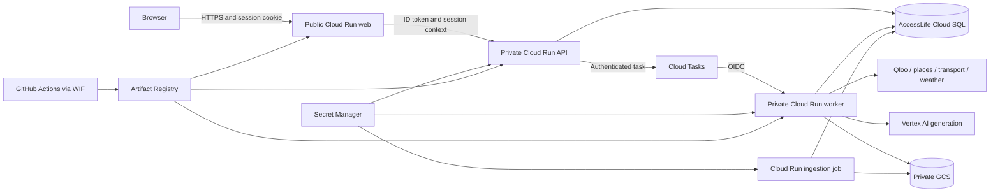
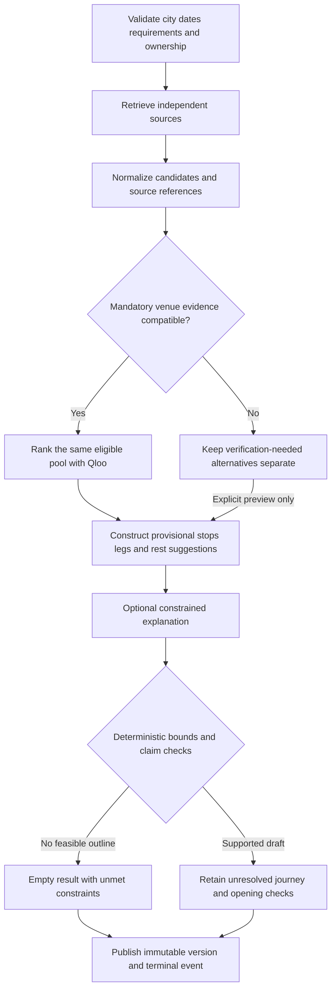

# AccessLife AI architecture

Revision 2 - 24 October 2026 - Local architecture implemented; managed GCP rollout authorized

## Current implementation

- Server pages/layouts render the Next.js shell. An interactive client controller coordinates forms/workspace with separate place/evidence, trip and lazy MapLibre modules. Further controller decomposition is technical debt; optional charts, animation and agent graphs are deferred.
- Pydantic owns request and snapshot contracts. OpenAPI export and generated frontend types include plans and trips. `composition.py` binds replaceable provider ports; raw provider responses never become React models.
- A fixed LangGraph supervisor runs independent sources -> eligibility/ranking -> provisional construction -> constrained explanation. This is deterministic orchestration, not an autonomous conversational supervisor. Vertex uses ADC and Google Gen AI; Groq is a configured transient fallback. Facts survive language-service failure.
- PostgreSQL stores sessions, runs, events, checkpoints, leases, immutable plan versions, trip revisions, quotas and permits. PostGIS stores venue coordinates; pgvector and lexical search retrieve a 12-summary original corpus with CPU ONNX MiniLM, 384 dimensions. This is a smoke corpus, not the held-out recall benchmark.
- Local Compose has web, API, a separate PostgreSQL queue worker and PostgreSQL 16 with both extensions. Cloud Tasks uses the same durable claims. `_dispatch` checkpoints reserve task names before enqueue. Retries reuse reservations; reconciliation rotates stale names, recovers expired leases, bounds attempts and cleans expired records. SSE replays saved sequences; session discovery resumes an active browser run.
- Current frontend features are `planner/`, `places/`, `trips/`, `map/`. Backend modules are `api/`, `domain/`, `application/`, `agents/`, `ports/`, `adapters/`, `persistence/`; the worker is `worker.py` and Alembic lives in `apps/api/migrations/`. The larger tree below is the target decomposition.

Transport adapters expose capabilities and available line status, not complete accessible routing. OSM discoveries are unknown-access previews; the planning pool is curated. No current plan is fully validated. Private GCS buckets are reserved for permitted document/backup workflows; the tiny catalogue currently ships with the backend. The separate SQL instance currently uses one application database principal for migrations and runtime; splitting a restricted runtime DML role from the migration owner remains production hardening.

Real credentials use server-side `*_API_KEY_SECRET` references and ADC/Secret Manager. SQL passwords and secret payloads use Terraform ephemeral variables/write-only fields, avoiding plaintext plans/state. Never publish payloads or proprietary Qloo responses. Secret readers cache values until restart; restart after rotation.

## 1. Architectural decisions

Build a modular application with replaceable provider adapters, a Next.js frontend and a FastAPI/LangGraph backend. Deploy logical modules together unless they need a different lifecycle: web, API, planning worker and batch ingestion. Do not create a microservice for each specialist tool.

The product covers London, New York, Paris, Berlin and Chicago. A trip aggregates city plans; it does not verify transport between cities. The managed GCP architecture supersedes the reference's single-VM deployment. Keep the original reference files local; the six maintained documents in `ai/` are the published specification.

| Decision | Default | Reason and boundary |
|---|---|---|
| Web | Next.js App Router and strict TypeScript | Server-rendered shell; narrow client islands |
| API | FastAPI, Pydantic, SQLAlchemy, Alembic | Typed contracts, explicit transactions and migrations |
| Orchestration | LangGraph Supervisor with deterministic tools | Parallel independent IO; dependent checks remain ordered |
| Database | Separate PostgreSQL 16 Cloud SQL instance | PostGIS facts, pgvector retrieval, durable runs/events and plan versions |
| Generation | Configurable Vertex AI model adapter | Verify available model, location, quota and price before deployment |
| Embeddings | CPU `sentence-transformers/all-MiniLM-L6-v2`, 384 dimensions | Small curated English corpus; no GPU or locally hosted large LLM |
| Async work | Cloud Tasks to an IAM-protected worker | Planning continues independently of the browser connection |
| Object storage | Private GCS documents and backups buckets | Bounded permitted data and recoverable manifests |
| Deployment | Terraform and GitHub Actions using WIF | Reproducible resources without downloaded service-account keys |

Use supported stable versions, pin exact package/model/image revisions during implementation and commit lockfiles. Exact installed versions are in the dependency lockfiles.

## 2. Deployment and trust boundaries



The browser calls only same-origin `/api/v1/*` routes. Next.js forwards them to private FastAPI `/v1/*`, adding an ID token for the API audience and trusted anonymous-session context. The forwarding layer performs transport/session duties, not recommendation logic. Stream SSE without buffering or caching. Cloud Run's generated HTTPS web URL is sufficient for the first release; a custom domain is optional.

Use IAM authentication for private Cloud Run services; “private” does not mean network-only ingress. Cloud Tasks must be able to reach its worker URL with the task invoker's OIDC token. Choose ingress settings compatible with that path and verify unauthorized requests are rejected. The web service identity can invoke API; it cannot invoke planning internals or read the database directly.

Cloud Run uses its managed Cloud SQL socket attachment with IAM cloudsql.client authorization; psycopg connects through that socket using the application database credential from Secret Manager. Initial budget-conscious networking uses a public instance IP with no authorized external networks; managed-proxy encrypted connections only. This is not an unauthenticated database endpoint. If policy requires private IP, explicitly price and provision the required networking before replacing this default.

### GCP resource plan

Project: `project-bb13ecd8-9d67-408d-9a7`. Default deployment region: `asia-south1`. Use explicit project/region arguments rather than changing workstation-wide defaults. Existing PharmaGuard resources are unrelated and must not be modified or imported into AccessLife Terraform state.

| Resource | Proposed name or allocation | Initial control |
|---|---|---|
| Web Cloud Run | `accesslife-web` | 1 vCPU, 1 GiB, min 0, max 2 instances |
| API Cloud Run | `accesslife-api` | 1 vCPU, 1 GiB, min 0, max 2, request concurrency 20 |
| Worker Cloud Run | `accesslife-worker` | 2 vCPU, 4 GiB, min 0, max 1, request concurrency 3 |
| Planning queue | `accesslife-planning` | At most 3 concurrent dispatches; bounded rate and attempts |
| Cloud SQL | `accesslife-db` | PostgreSQL 16 Enterprise, single zone, `db-custom-1-3840`, 20 GB SSD; quote before creation |
| SQL storage growth | Same instance | Autoresize capped at 40 GB; application quotas apply first |
| Object buckets | `accesslife-docs-<project-id>`, `accesslife-backups-<project-id>` | Uniform access, public access prevention and lifecycle rules |
| Images | `accesslife` Artifact Registry repository | Immutable revision tags/digests, bounded retained images |
| Ingestion | `accesslife-ingest` Cloud Run job | One task, parallelism 1, 1 vCPU / 2 GiB, manually invoked initially |
| Terraform state | Dedicated AccessLife GCS state bucket/prefix | Restricted access, versioning, never committed |
| Identity and secrets | Resource-scoped AccessLife accounts/secrets | No Owner/Editor grants and no public secrets |

These are initial allocations. The dated forecast is in [COST_REVIEW.md](../infra/COST_REVIEW.md); deployed results are in memory.md. Default min instances are zero; any temporary warm capacity during judging must be included in the estimate. Cold-start latency is measured separately from warm planning.

Limit connection pools: API 5 per instance, worker 5 and each maintenance job 5. With initial instance maxima and one maintenance job, this is up to 20 application connections; leave capacity for migrations, health checks and administration. Enable pre-ping, connection recycling and bounded pool checkout. Never hold database connections while awaiting external provider calls.

Service identities are separate for web, API, worker, task invocation, ingestion and CI deployment. API can enqueue tasks and use its database role. Worker can read only its required secrets/objects and call the selected model. The task invoker has only worker invocation rights. CI's WIF trust is restricted to this repository and intended branch/environment; it does not use a project-wide Owner role.

## 3. Component boundaries and repository structure

```text
ai/                                  # Six maintained specifications; originals ignored
apps/
  web/src/
    app/                             # Server pages/layouts and thin API forwarding
    components/ui/                   # Shared accessible primitives
    components/layout/               # Shell/navigation/responsive panels
    features/
      cities/ discovery/ accessibility/ itinerary/
      trips/ taste/ evidence/ agents/ map/ transport/ weather/
    lib/api/                         # Generated contract client and SSE transport
  api/src/accesslife/
    api/                             # FastAPI routers, auth/context, HTTP mapping
    domain/                          # Facts, requirements, eligibility, plan/trip models
    application/                     # Use cases and transaction boundaries
    agents/                          # Graph state, nodes, orchestration
    ports/                           # Provider and repository interfaces
    adapters/                        # Qloo, OSM, city transit, weather, Vertex, GCS
    persistence/                     # SQLAlchemy repositories and Alembic migrations
    worker/                          # Authenticated task handler, leases and cancellation
packages/contracts/                  # Exported OpenAPI and generated TypeScript
ingestion/                           # Source manifests, parsing, chunking and admission
infra/terraform/                     # AccessLife resources and resource-scoped IAM
infra/containers/                    # Web, API/worker and ingestion image definitions
tests/contracts/                     # Provider/schema contract tests
tests/scenarios/                     # Eligibility, local plans and multi-city cases
tests/retrieval/                     # Annotated questions and retrieval evaluation
tests/e2e/                           # Browser journeys, failure states and accessibility
```

This is the target decomposition; current modules are listed in the checkpoint above. Within each frontend feature use `components/`, `hooks/`, `schemas/` and a public `index.ts` only as needed. Do not add empty abstractions simply to fill the tree.

Dependency direction: HTTP/UI → application use cases → domain/ports. Adapters implement ports and are selected at the composition root. Domain code imports neither FastAPI nor provider SDKs. Graph nodes call use cases/ports; they do not read another provider's internal response. Provider swaps change configuration and adapter construction, not cards or validators.

### Replaceable ports

| Port | Minimum methods | Normalized result |
|---|---|---|
| `PlacesProvider` | `search(city, area, categories)` | Candidate identity, coordinates and source references |
| `AccessEvidenceProvider` | `lookup(place_ids, required_features)` | Feature facts, conflicts, provenance and unresolved requirements |
| `TasteProvider` | `resolve_interests(seeds)`, `rank_candidates(context, candidates)` | Matched seed/entities, raw scores, semantics, comparability group and unmapped IDs |
| `TransitProvider` | `capabilities(city)`, `plan_leg(origin, destination, time, constraints)` | Legs, geometry where supported, distances, schedules, access facts and unknowns |
| `WeatherProvider` | `forecast(coordinates, local_window)` | Forecast values, issue time and supported horizon |
| `KnowledgeRetriever` | `retrieve(query, city, corpus_version)` | Passages, source/section/page, evidence IDs and retrieval metadata |
| `GenerationProvider` | `interpret(text, schema)`, `explain(validated_plan, evidence)` | Schema-validated intent or evidence-referenced explanation |
| Persistence ports | Transactional run/event, plan, trip and evidence operations | Domain models with ownership and version checks |
| `TaskDispatcher` | `enqueue(run_id, dispatch_generation)` | Stable task reference and accepted/duplicate/error state |

Every provider returns explicit status and freshness, not an empty list that hides an outage. Contract tests run against each adapter and against recorded sanitized fixtures. Live smoke tests are separate and never rewrite fixtures automatically.

## 4. Domain data and ownership

Pydantic domain/API schemas are the canonical wire contract. Export FastAPI OpenAPI and generate TypeScript into `packages/contracts/`; validate runtime user input with Zod without inventing a second incompatible wire model. IDs are opaque UUIDs except stable city slugs. Distances use metres, durations seconds and timestamps RFC 3339 with offsets; store instants in UTC plus the city's IANA time zone.

| Entity | Fields and invariants |
|---|---|
| `City` | ID, display name, time zone, supported geometry, coverage state, capabilities and source references |
| `MobilityRequirements` | Required features, accepted limitations, per-leg/total distance, rest interval and transfer limits; zero is distinct from missing |
| `Evidence` | ID, source URL/type, provider object ID, retrieved/updated timestamps, rights, transformation version and supported claim |
| `AccessFeatureFact` | Feature, value, status, evidence references, freshness classification and independent conflict flag |
| `CandidateEvidence` | Place/provider identities, access facts, transport, weather, taste evidence, eligibility and unresolved conditions |
| `PlanRun` | Session, request snapshot, state, deadlines, lease owner/expiry, attempt, graph/checkpoint version and cancellation generation |
| `RunEvent` | Run ID, strictly increasing sequence, timestamp, stage, status, elapsed time, evidence count and public summary |
| `PlanVersion` | Plan ID/version, run, inputs, stops/legs/rests, evidence snapshot, validation and provider states; immutable |
| `Trip` | Session, revision and ordered city segments; each references an exact local plan version |
| `TransferGap` | Neighboring segment IDs and `user_arranged_unverified`; user notes never become provider evidence |
| `CorpusVersion` | Source/model/tokenizer/chunker revisions, admitted quantities and promoted/retired state |

Store normalized place/access data in PostGIS-backed tables; documents/chunks and full-text vectors in PostgreSQL/pgvector; run events and plan versions durably in relational tables. Provider cache entries include key scope, provider, retention policy, expiry and rights. Private GCS stores admitted raw documents and bounded backups, not the canonical plan state.

Conflicting facts retain both sources. An LLM cannot resolve conflict by preferring the more optimistic statement. Freshness rules are source-specific and versioned; the initial coverage phase must define them before a city's `ready` gate. Historical plan snapshots preserve what was known then but display that historical status on later viewing.

## 5. Public API contract

Browser prefix: `/api/v1`. Internal FastAPI prefix: `/v1`. The following table omits the prefix. Require anonymous-session ownership for every nonpublic resource. Health and city catalogue responses expose no personal data.

| Method and path | Request | Response and behavior |
|---|---|---|
| `POST /sessions` | Empty body | Establish secure HttpOnly anonymous-session cookie through web; session expires in 24 h |
| `DELETE /sessions/current` | Current session | Clear cookie; revoke session, cancel runs and delete active personal records |
| `GET /cities` | None | City IDs/time zones, coverage state, supported areas and capabilities |
| `POST /trips` | Title and ordered city/date segments | `201`, trip ID, revision and unverified transfer placeholders |
| `GET /trips/{trip_id}` | Session | Trip, segment statuses and exact plan-version references |
| `PATCH /trips/{trip_id}` | Expected revision and segment edits | New revision; conflicting revision returns `409` |
| `POST /plans` | City, area, local window/time zone, requirements, interests; optional trip segment; `Idempotency-Key` | `202`, plan ID, run ID and progress URL after durable dispatch acceptance |
| `GET /plans/{plan_id}` | Optional `version` query | Latest published or explicitly requested version; pending state if none published |
| `POST /plans/{plan_id}/replan` | Expected version, changed inputs, `Idempotency-Key` | `202`, new run ID; stale expected version returns `409` |
| `POST /runs/{run_id}/cancel` | Session | Idempotent cancellation request; worker checks before publication |
| `GET /runs/{run_id}/events` | `Last-Event-ID` on reconnect | SSE replay and live progress until terminal state |
| `GET /evidence/{evidence_id}` | Session/visibility context | Permitted excerpt, exact claim, attribution and timestamps; never unrestricted document download |
| `GET /plans/{plan_id}/impact` | Exact plan version | Same eligible snapshot, baseline/Qloo orders, score semantics and provider state |
| `GET /health/live` | None | Minimal process liveness |
| `GET /health/ready` | None | Sanitized readiness, `503` on required dependency failure |

The worker endpoint `/internal/runs/{run_id}:execute` is not browser-proxied. It requires the queue's IAM identity and validates task/run metadata. Schema-invalid requests return `422`; denied or unknown session resources return a uniform `404` where revealing existence would leak ownership.

Example intake shape (illustrative coordinates are omitted; the city area is chosen from its registry):

```json
{
  "city_id": "london",
  "window": {
    "starts_at": "2026-10-29T10:00:00+00:00",
    "ends_at": "2026-10-29T15:00:00+00:00",
    "time_zone": "Europe/London"
  },
  "mobility": {
    "required_features": ["step_free_entrance", "accessible_toilet"],
    "accepted_limitations": [],
    "max_leg_distance_m": 200,
    "max_total_distance_m": 1000,
    "rest_every_minutes": 45,
    "max_transfers": 1
  },
  "interests": [{"name": "jazz", "kind": "music"}]
}
```

Errors use a stable envelope: `error.code`, safe `error.message`, `error.retryable`, `error.request_id` and optional field errors. Do not expose tracebacks, raw provider payloads or secrets. Validation errors identify a correction; `429` includes retry guidance; transient dependency failures map to a retryable `503` or explicit partial result as appropriate.

### Sessions and ownership

Generate an opaque cryptographically random session token; store only its hash. The web layer strips browser-supplied internal identity headers and forwards session context only after validation. Check ownership in the API, not solely in the browser. Use Secure, HttpOnly and SameSite=Lax cookies in production, strict Origin checks for mutations and no permissive credentialed CORS.

Session tokens, mobility inputs and precise user location stay out of logs, URLs and public cache keys. Return `Cache-Control: no-store` for plans, trips, session responses and SSE. “Clear session” deletes active personal rows and marks backup retention explicitly; backups expire under their documented policy rather than being silently rewritten.

## 6. Planning, ranking and durable execution



Current published drafts never receive confirmed journey status. Future confirmation requires compatible current evidence for every required stop and leg, actual route distances/times and opening/rest conditions; a successful task or generated explanation cannot establish it.


The first fan-out includes places, taste-interest resolution, weather, transit capability/freshness and RAG guidance. Route calls and taste scoring follow identity resolution and shortlist selection. CPU embedding uses one bounded worker process and two model threads initially; it must not block the async request loop. Bulk ingestion is disabled during judge sessions.

### Idempotency and dispatch

1. In a transaction, reserve the session/idempotency key and canonical input hash, create the run and record pending dispatch. Reusing a key with different input returns `409`.
2. Dispatch a deterministic task name based on run ID and dispatch generation. A known `AlreadyExists` for that name is a successful duplicate dispatch, not a second run.
3. Return `202` only after queue acceptance. On an uncertain or failed enqueue, retain pending state and return a safe retryable response; the same key reconciles and retries rather than creating a new run.
4. A periodic authenticated reconciliation job checks pending-dispatch records and expired leases. Implement this before public release so abandoned clients cannot leave runs permanently stranded. Schedule with a scoped Cloud Scheduler identity; terminal/exhausted records are never re-enqueued indefinitely.
5. Worker acquires a database lease atomically and persists checkpoints. Duplicate delivery observes the live lease/terminal state and produces no duplicate plan. An expired lease can be reclaimed with bounded attempts. Cloud Tasks retries and database lease rules must agree.

Use a maximum of three execution attempts per run, with transient provider retry once inside an attempt only if time remains. A logical planning attempt has a 30-second deadline; configure the task handler deadline at 60 seconds to allow safe cleanup. Cancellation and a superseding generation are checked between tools and immediately before the publication transaction. A crash after publication but before queue acknowledgement replays as a no-op.

Persist checkpoint state and event sequence allocation in PostgreSQL. Do not keep the authoritative graph checkpoint only in worker RAM. Publish plan version, trip-segment attachment if still current, and terminal event in one transaction with an expected-version comparison. A losing concurrent replan does not overwrite the winning plan.

### Concurrency and SSE

Queue concurrency is 3; database leases enforce at most three active local runs across instances. Each run has at most five provider calls in flight, with an additional cross-run limit of 12 using expiring database-backed permits. All limits release on success, error, timeout or cancellation. Ingestion uses a separate bounded path.

SSE event IDs equal a monotonically increasing per-run sequence. Persist events before emitting them. Each event contains `run_id`, `sequence`, `plan_version` when assigned, stage/agent, status, elapsed time, evidence count and a short public action. Heartbeats keep idle streams observable but do not allocate domain events.

Replay events strictly after `Last-Event-ID`; ignore duplicates in the client. Streams read durable state, so reconnection may reach another API instance. Cap each stream below Cloud Run/proxy request timeouts and reconnect with backoff. Close on terminal state; reconnecting to a completed run replays the terminal result. Unknown/expired run histories return a documented safe error and fetchable plan state rather than hanging.

### Ranking policy

First enforce all mandatory conditions. Baseline ordering is travel duration ascending, explicit category preference descending, then stable place ID. Qloo ordering sorts mapped eligible candidates by comparable returned affinity descending, then uses the same baseline tie-break. Unmapped candidates follow in baseline order with “Taste match unavailable.” This ordering policy is a product heuristic, not calibrated enjoyment prediction.

Only compare raw scores within the provider's declared comparability group. If an adapter cannot supply comparable scores for the same snapshot, mark the Impact Lab unavailable for that run instead of comparing unrelated requests. Both columns retain identical candidate IDs, evidence snapshot and timestamp. Never force a rank change or fabricate explainability links.

## 7. Evidence ingestion and retrieval

Admit only allowlisted sources with recorded rights, city/language scope and provenance. The initial small English corpus supplements structured facts. Do not bulk ingest Qloo responses or private session profiles.

| Budget | Initial policy |
|---|---|
| Sources | Begin with 100–500 useful documents across five cities; hard ceiling 2,000 |
| Raw source bytes | Target at most 10 GB; hard cap 20 GB including retained revisions and staging |
| Retained clean text | Maximum 500 MB UTF-8 |
| Active chunks | Start 5,000–50,000; hard cap 100,000 |
| RAG relations/indexes | 5 GB operational allowance; pause admission at 80%, reject at 100% |
| Whole application DB | 15 GB logical allowance with separate WAL/storage monitoring |
| Each document | At most 50 MB, 500 pages and 120-second parsing budget |

Use bounded download → checksum deduplication → parsing in a restricted process → boilerplate/near-duplicate removal → model-token counting → transactional quota reservation → embedding/staging → validation → corpus promotion. Release reservations on failure. Keep current and at most one prior corpus revision inside the shared budget. GCS capacity is not an automatic 20 GB cap; reconcile a quota ledger against actual object generations and staging.

MiniLM chunks use 180–220 model word pieces with 30–40 overlap and at most 256 including heading context and special tokens. Record tokenizer, model commit and chunker revision; do not count characters as tokens. Normalize 384-dimensional vectors and use cosine search. A model change rebuilds the corpus under a new version even if dimensionality is unchanged.

Retrieval applies city, language and corpus-version filters, gathers 20 dense and 20 lexical candidates, combines by reciprocal rank fusion, removes duplicates and sends four to six permitted passages within the model context budget. Start with exact filtered search; add HNSW only after measuring latency and Recall@5. No default cross-encoder or second vector database.

OSM place-cache starting TTL is 24 hours; weather starting TTL 30 minutes, within forecast horizon. Transport follows operator feed validity and live update cadence. Access-source and Qloo retention/freshness rules require explicit source/account validation in Phase 1; until configured, they cannot establish a ready city. Cache keys include city, outing time, requirements/version as appropriate, and provider/model revision.

## 8. Multi-city consistency

Trips are aggregate records, not a new routing engine. Each segment references an immutable local plan version; independent city runs can execute concurrently within the global limits. Capture start/end instants plus each city's local time zone. Reject overlapping segment windows; require explicit resolution of nonexistent or ambiguous local times. Do not assume identical offsets in different cities.

A trip exposes local-plan status separately from transfer status. All inter-city gaps remain `user_arranged_unverified` in the MVP, even if local plans pass. Notes and external links supplied by a user do not establish confirmed travel duration or accessibility. Reordering/deleting segments updates transfer placeholders and invalidates affected references atomically; it never silently changes the local plan snapshot.

## 9. Operations, budget and recovery

Before provisioning, price the proposed resources in the selected region through at least 5 November, extending for required follow-up. Forecast includes SQL runtime/storage/backups, Cloud Run and build time, Cloud Tasks/Scheduler, model tokens, GCS, networking, registry and logs. Compare incremental AccessLife spend against **US$80**; if the forecast is higher, stop provisioning and present the priced adjustment. Do not claim existing billing credit has been verified by this specification.

Use labels `app=accesslife`, `environment=hackathon` and an explicit owner/lifecycle inventory where supported. In a shared project, project budgets also see unrelated spend; configure resource attribution where supported and otherwise reconcile labeled usage plus an application request/token ledger. Budget alerts at 25%, 50%, 75% and 90% are not hard caps. Bound instances, admitted runs, daily model tokens, ingestion and log retention; public rate limits must not rely on IP alone.

Default application logs exclude user content and retain for 7 days where platform policy allows; verify bucket retention settings explicitly. Metrics include queue age, run latency, provider errors, stale evidence, SQL connection/storage use, token usage and remaining envelope. Keep operational detail in protected tools rather than the public agent inspector.

Keep daily managed SQL backups for 7 days and bounded encrypted logical exports to the private backups bucket for 7 days; include both costs. No HA replica is assumed for this budget. Enable deletion protection and test restore into an isolated target before release. Pin images by digest; roll back Cloud Run revisions without destructive schema changes. Migrations use expand/contract compatibility and a backup before any destructive operation.

Before final teardown, export permitted data/manifests/configuration, verify restoration, then inventory only AccessLife-owned resources. Remove services/jobs/queues/schedules, SQL and retained backups when authorized, objects/versions, image revisions, secrets and IAM/WIF bindings that are no longer needed. Never disable project APIs or delete shared project resources to clean up this application. Keep the working app through judging and required follow-up; 3 November is a review checkpoint, not automatic destruction.

## 10. References and validation boundaries

- [Next.js Server and Client Components](https://nextjs.org/docs/app/getting-started/server-and-client-components)
- [Cloud Run and Cloud Tasks](https://docs.cloud.google.com/run/docs/triggering/using-tasks)
- [Cloud Run streaming/reconnection considerations](https://docs.cloud.google.com/run/docs/triggering/websockets)
- [Cloud SQL supported extensions](https://docs.cloud.google.com/sql/docs/postgres/extensions)
- [Cloud SQL Python connector](https://github.com/GoogleCloudPlatform/cloud-sql-python-connector)
- [pgvector](https://github.com/pgvector/pgvector)
- [MiniLM model card](https://huggingface.co/sentence-transformers/all-MiniLM-L6-v2)
- [Workload Identity Federation for deployment pipelines](https://docs.cloud.google.com/iam/docs/workload-identity-federation-with-deployment-pipelines)

Qloo endpoint/authentication details, account permissions, provider field semantics, city coverage, Vertex model availability and regional costs must be verified during implementation. The organizer-linked Qloo guide could not be retrieved in the planning review; do not turn guessed endpoint shapes into production contracts.

Related documents: [PRD](prd.md), [rules](rules.md), [phases](phases.md), [design](design.md), [memory](memory.md).
