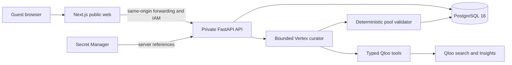

# Taste Duel architecture

The application is a modular web/API system. Its agents do not require separately deployed services.

| Boundary | Responsibility |
|---|---|
| Next.js | Server shell/public metadata; narrow interactive search, gameplay and result components |
| Same-origin forwarding | Path/header allowlists, exact mutation origins, host-scoped cookies and API IAM |
| FastAPI | Sessions, canonical request signatures, generation claims, answers, advancement and replay |
| QlooPort | Typed seed resolution and normalized snapshots; provider envelopes never reach React |
| RoundCuratorAgent | Bounded supported-domain/candidate decisions, validator feedback and at most one correction |
| DuelPoolBuilder | Eligibility, verified ordering, tie rejection, no-repeat feasibility, diversity and sides |
| PostgreSQL | Private pools/receipts, immutable evidence, RLS, idempotency and shared provider admission |

Python/Pydantic owns the wire schemas. Exported application OpenAPI generates frontend types; an unverified upstream schema never drives those contracts.

## Generation and authority

Generation is awaited inside the request. A transactional reservation combines owner, idempotency key and canonical input signature. Expiring claims have fencing, preventing a restarted request from publishing a second authoritative pool. Ready game, pool and private curation receipt commit atomically. A running reservation is not a promise from an undeployed background queue.

The Vertex curator may choose among verified target domains, inspect Qloo-grounded pool feedback and stop or correct its strategy. It cannot invent candidates, change scores, override rejection or determine winners. Actual genuine-agent/deterministic-Qloo mode is recorded.

The recorded deployment uses `gemini-3.1-flash-lite` at the global location with IAM/ADC and explicit typed HTTP search/`http_ranked` Qloo integration. The official `@qloo/qloo-harness@0.1.26` runtime is packaged and contract-tested; this is not a substituted claim of live MCP ranking success.

Hard limits include a 20-second acceptance envelope, at most six upstream Qloo requests including internal lookups/retries, at most four Vertex attempts, finite steps/tokens and one correction. Shared database admission coordinates replicas without resetting consumed usage.

## Gameplay and replay

Only the current playable round is delivered, without answer/rank/affinity/future-contestant fields. Acceptance locks authoritative state; identical retries return the saved reveal and conflicting answers fail. Explicit advancement is separately idempotent. Score is computed from stored accepted answers.

Solo adaptation selects from the validated unused pool without provider calls. Challenges freeze the creator’s exact five delivered comparisons, order, sides, context references and rule versions. Replay never refreshes the ranking. Post-answer evidence is limited to the accepted round; aggregate curation facts are completion-only.

GCP runs public web, private API, one migration job and ordinary PostgreSQL on the existing dedicated SQL instance. Web has API invocation permission rather than secret/database access; runtime and migration roles have separate privileges. No embedding model, ingestion pipeline, worker, second SQL instance or extra environment project is required.

[Local runtime](../apps/api/CONTAINERS.md) · [Exact release identities](../infra/migration/production-release-execution-2026-10-28.md)
